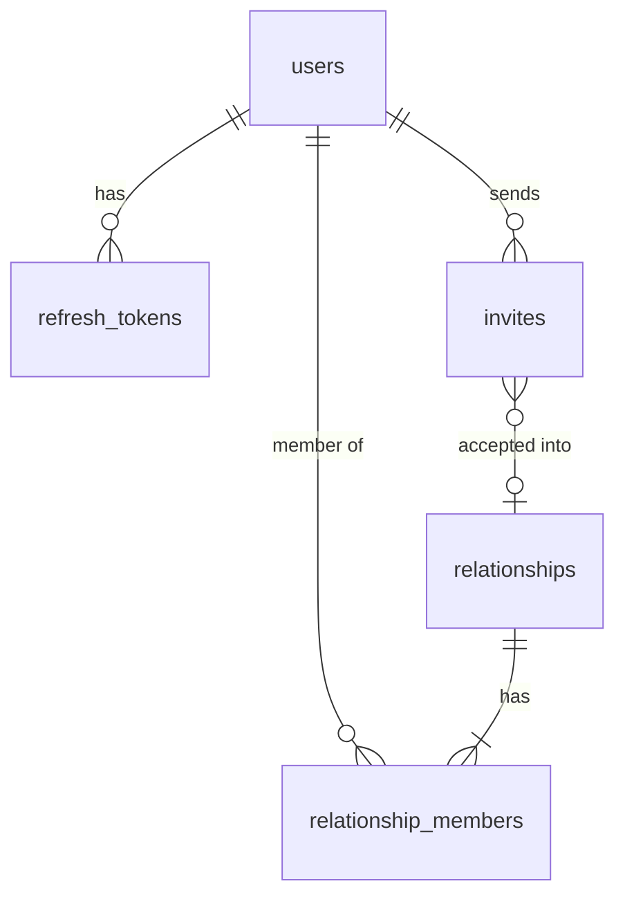

# What database:
- Postgres + SQLAlchemy

Conventions: PostgreSQL 17, SQLAlchemy 2 async models in `app/db/models/`, migrations with Alembic (see the backend README).

- Primary keys are `uuid` with `DEFAULT gen_random_uuid()`.
- Timestamps are `timestamptz`, stored in UTC.
- Enums are `text` with a `CHECK` constraint (easier to migrate than native Postgres enums).
- Secrets (passwords, tokens) are stored only as hashes, never in plain text.

# Schema design

Status: **design only**. Each version ships its own Alembic migration.

# Version 1

User flow: [versions/version1.md](../versions/version1.md).

## `users`

| Column | Type | Notes |
| --- | --- | --- |
| `id` | uuid PK | |
| `phone` | text, not null, **unique** | Normalized E.164 (`+14155550100`) before saving, so different formats map to one account. |
| `password_hash` | text, not null | argon2 (or bcrypt). Never the plain password. |
| `first_name` | text, not null | |
| `last_name` | text, not null | |
| `phone_verified_at` | timestamptz, null | Always null in v1. Set when SMS verification arrives. |
| `created_at`, `updated_at` | timestamptz, not null | |

There is **no `is_locked_with` column**. "Who am I locked with" comes from `relationship_members` (see below), for two reasons:
- A pointer on each user has to be written on both rows and can drift (A points to B, B points to nobody).
- It keeps no history. When unlocking exists, we want to know who was locked with whom and when.

## `refresh_tokens`

Needed for login sessions (short JWT access token + longer refresh token).

| Column | Type | Notes |
| --- | --- | --- |
| `id` | uuid PK | |
| `user_id` | uuid FK to `users`, not null | |
| `token_hash` | bytea, not null, unique | SHA-256 of the random token. |
| `expires_at` | timestamptz, not null | For example 30 days. |
| `revoked_at` | timestamptz, null | Set on logout or rotation. |
| `created_at` | timestamptz, not null | |

Index: `(user_id)`.

## `invites`

One row per invite link.

| Column | Type | Notes |
| --- | --- | --- |
| `id` | uuid PK | |
| `sender_id` | uuid FK to `users`, not null | User A. |
| `token_hash` | bytea, not null, **unique** | SHA-256 of the random token in the link. The link itself is not stored. It is built once (`projectlock://invite/<token>`), returned to A, and never shown again. |
| `status` | text, not null | `pending`, `accepted`, `declined`, `cancelled`, `superseded`. Default `pending`. |
| `expires_at` | timestamptz, not null | `created_at + 24 hours`. This is the TTL. |
| `responder_id` | uuid FK to `users`, null | Who accepted or declined (B). |
| `relationship_id` | uuid FK to `relationships`, null | Set when accepted. |
| `created_at` | timestamptz, not null | |
| `resolved_at` | timestamptz, null | When the status left `pending`. |

Constraints and indexes:
- `CHECK (status IN ('pending','accepted','declined','cancelled','superseded'))`.
- `CHECK (status = 'pending' OR resolved_at IS NOT NULL)`.
- `CHECK (status <> 'accepted' OR (responder_id IS NOT NULL AND relationship_id IS NOT NULL))`.
- `CHECK (responder_id IS NULL OR responder_id <> sender_id)`: you cannot accept your own invite.
- Partial `UNIQUE (sender_id) WHERE status = 'pending'`: at most one open invite per sender. Creating a new invite cancels the old one in the same transaction.

**Expired is not a stored status.** An invite is expired when `status = 'pending' AND expires_at < now()`. The API reports it as `expired`. No background job is needed, and there is no window where the row says `pending` but the invite is really dead.

## `relationships`

One row per lock.

| Column | Type | Notes |
| --- | --- | --- |
| `id` | uuid PK | |
| `status` | text, not null | `active` or `ended`. v1 only creates `active` (`ended` is for the dev-only unlock). |
| `locked_at` | timestamptz, not null | Shown on the Locked screen ("Locked for N days"). |
| `ended_at` | timestamptz, null | |
| `created_at` | timestamptz, not null | |

Constraint: `CHECK ((status = 'active') = (ended_at IS NULL))`.

## `relationship_members`

Two rows per relationship, one for each person. This table is what guarantees **one active lock per user**.

| Column | Type | Notes |
| --- | --- | --- |
| `relationship_id` | uuid FK to `relationships`, not null | |
| `user_id` | uuid FK to `users`, not null | |
| `active` | boolean, not null | Copy of `relationships.status = 'active'`, so the index below can use it. |

Constraints and indexes:
- `PRIMARY KEY (relationship_id, user_id)`.
- **Partial `UNIQUE (user_id) WHERE active`**: a user can be in only one active lock. If two accepts race, the second insert fails here even if the app check missed it.

## Derived state (computed, not stored)

| State | How |
| --- | --- |
| Locked | A `relationship_members` row with `user_id = me AND active`. |
| My partner | The other member of that relationship. |
| Single | Not locked. |
| Invite expired | `status = 'pending' AND expires_at < now()`. |

## The accept transaction

When B accepts invite I from A, in one transaction:
1. Load the invite by `token_hash` and lock it (`SELECT ... FOR UPDATE`). It must be `pending` and not expired, and B must not be A.
2. Lock A's and B's `users` rows in a fixed order (by `id`) to avoid deadlocks.
3. Check neither has an active `relationship_members` row. If one does, return "already locked".
4. Insert `relationships` and two `relationship_members` rows (`active = true`).
5. Set the invite to `accepted` with `responder_id = B`, `relationship_id`, and `resolved_at`.
6. Set every other `pending` invite sent by A or B to `superseded`.
7. Commit.

The partial unique index on `relationship_members` is the safety net if anything above is ever wrong.

## Not in v1 (comes later)

- Phone verification data (SMS codes or login links).
- ID verification and the optional "Verified Lock".
- Certificates, vault, presence, breach events, device tokens, ledger, purchases.
