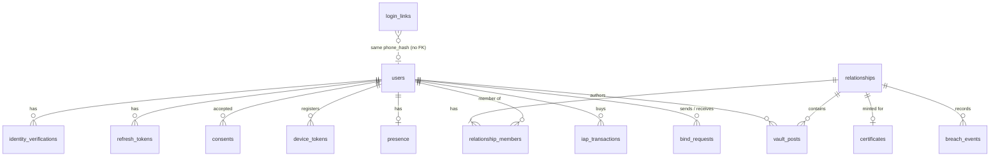

# What database:
- Postgres + SQLAlchemy

Conventions: PostgreSQL 17, SQLAlchemy 2 async models in `app/db/models/`, migrations with Alembic (see the backend README).

# Schema design

Status: **design only**. Tables are marked with the phase that creates them. Each phase ships its own Alembic migration.

## Conventions

- Primary keys are `uuid` with `DEFAULT gen_random_uuid()` (built into Postgres 17). Exception: `certificates.serial` (identity counter).
- All timestamps are `timestamptz`, stored in UTC.
- Enums are `text` with a `CHECK` constraint (easier to migrate than native enums).
- Hashes are `bytea` (32 bytes, HMAC-SHA256).
- The **raw phone number, raw ID number, and ID images are never stored.** Only hashes. Typed phone numbers are used in memory to hash and to send the link, then dropped.
- Rows that belong to a relationship are never deleted by app code. Relationships are archived (`status='ended'`).
- Derived state is computed, not stored, so it cannot drift (see "Derived state").

## Overview (ER diagram)

## Phase 1 tables

### `users`

| Column | Type | Notes |
| --- | --- | --- |
| `id` | uuid PK | |
| `handle` | text, null | Unique on `lower(handle)`. Null until the profile step. Set to null again at purge. |
| `display_name` | text, null | |
| `photo_key` | text, null | Object key in the bucket (MinIO locally, S3 in prod). Not a URL. |
| `status` | text, not null | `pending_verification`, `verified`, `deactivating`, `purged`. Default `pending_verification`. |
| `verification_method` | text, null | `dev_manual` (typed ID number, no real check) or `stripe`. Lets us find and re-verify dev-era accounts. |
| `verified_at` | timestamptz, null | Set when the ID step is approved. |
| `phone_verified_at` | timestamptz, null | Stays null while links are the dev workaround. Set when real phone verification exists. |
| `id_hash` | bytea, null | **Unique.** Null until the ID step is approved, and again after purge. Immutable once set (see trigger). |
| `phone_hash` | bytea, null | **Unique.** Set when the account is created from a login link. Null after purge. Immutable once set. |
| `hash_version` | smallint, not null | Default 1. Identifies the normalization and pepper version used for both hashes. |
| `deletion_requested_at` | timestamptz, null | Set by `POST /users/me/deletion` (Phase 3C). |
| `deletion_scheduled_for` | timestamptz, null | `deletion_requested_at + 90 days`. Cleared when the user logs in again. |
| `purged_at` | timestamptz, null | Set by the purge job. |
| `created_at`, `updated_at` | timestamptz | |

Constraints and indexes:
- `UNIQUE (id_hash)` and `UNIQUE (phone_hash)`. Postgres allows many nulls, so unverified and purged rows do not collide.
- `UNIQUE INDEX ON (lower(handle))`.
- `CHECK (status IN (...))`, `CHECK (verification_method IN ('dev_manual','stripe'))`.
- `CHECK (status <> 'deactivating' OR deletion_scheduled_for IS NOT NULL)`.
- Partial index `ON (deletion_scheduled_for) WHERE status = 'deactivating'` for the purge job.
- **Immutability trigger** `BEFORE UPDATE`: if `OLD.id_hash` or `OLD.phone_hash` is not null and the new value differs, raise an error, unless the transaction sets `app.allow_purge = 'on'` (`SET LOCAL`, used only by the purge job).

Why the user row is kept after purge: relationships and Past Matches reference it. The purge nulls the hashes, handle, name, and photo and sets `status='purged'`. The partner sees a "Deleted user" placeholder.

### `login_links` (replaces `phone_verifications`; dev workaround for SMS OTP)

| Column | Type | Notes |
| --- | --- | --- |
| `id` | uuid PK | |
| `phone_hash` | bytea, not null | Who requested the link. No FK, because the user may not exist yet. |
| `token_hash` | bytea, not null, unique | SHA-256 of a 32-byte random token. The plain token only appears in the link. |
| `expires_at` | timestamptz, not null | 15 minutes after creation. |
| `consumed_at` | timestamptz, null | Single use. Set in the same transaction that issues the tokens. |
| `requested_ip` | inet, null | For rate limiting and audit. |
| `created_at` | timestamptz | |

Index: `(phone_hash, created_at DESC)`. A cleanup job deletes rows older than 7 days.

Later (real SMS or Twilio Verify): same table. Only the sender changes, and `users.phone_verified_at` gets filled in.

### `identity_verifications`

| Column | Type | Notes |
| --- | --- | --- |
| `id` | uuid PK | |
| `user_id` | uuid FK to `users` | |
| `method` | text, not null | `dev_manual` or `stripe`. |
| `status` | text, not null | `pending`, `approved`, `rejected`. |
| `document_country` | char(2), null | |
| `provider_ref` | text, null | Stripe VerificationSession ID. Null for `dev_manual`. |
| `provider_event_id` | text, null, unique | Stripe event ID, for webhook idempotency. |
| `failure_code` | text, null | For example `ID_ALREADY_REGISTERED`. |
| `created_at`, `completed_at` | timestamptz | |

This is an audit trail. No image, document number, or date of birth is stored.

### `refresh_tokens`

| Column | Type | Notes |
| --- | --- | --- |
| `id` | uuid PK | |
| `user_id` | uuid FK to `users` | |
| `family_id` | uuid, not null | Shared by every token rotated from one login. Reuse of a revoked token revokes the whole family. |
| `token_hash` | bytea, not null, unique | |
| `expires_at` | timestamptz, not null | 30 days. |
| `revoked_at` | timestamptz, null | |
| `replaced_by_id` | uuid, null | |
| `created_at` | timestamptz | |

Indexes: `(user_id)`, `(family_id)`.

### `consents`

| Column | Type | Notes |
| --- | --- | --- |
| `id` | uuid PK | |
| `user_id` | uuid FK to `users` | |
| `type` | text, not null | `terms`, `identity_lock`, `location_sharing`, `public_ledger`. |
| `version` | text, not null | Version of the consent text shown. |
| `accepted_at` | timestamptz, not null | |

`UNIQUE (user_id, type, version)`. Append-only.

## Phase 2 tables

### `relationships`

| Column | Type | Notes |
| --- | --- | --- |
| `id` | uuid PK | |
| `user_a_id`, `user_b_id` | uuid FK to `users` | Ordered: `user_a_id < user_b_id`. |
| `status` | text, not null | `active` or `ended`. |
| `locked_at` | timestamptz, not null | |
| `ended_at` | timestamptz, null | |
| `ended_reason` | text, null | `mutual`, `divorce_fee`, `deletion_purge`. |
| `ended_by_user_id` | uuid FK, null | Who ended it (null for `deletion_purge`). |
| `created_at` | timestamptz | |

Constraints:
- `CHECK (user_a_id < user_b_id)` (also rejects self-pairing).
- `CHECK ((status = 'active') = (ended_at IS NULL))`.
- `CHECK (status = 'active' OR ended_reason IS NOT NULL)`.
- Partial `UNIQUE (user_a_id, user_b_id) WHERE status = 'active'`.

### `relationship_members`

One row per user per relationship. It exists because a user can be `user_a` in one row and `user_b` in another, which no single-column unique index on `relationships` can catch.

| Column | Type | Notes |
| --- | --- | --- |
| `relationship_id` | uuid FK to `relationships` | |
| `user_id` | uuid FK to `users` | |
| `active` | boolean, not null | Mirrors the relationship status. |

`PRIMARY KEY (relationship_id, user_id)` and a **partial unique index `ON (user_id) WHERE active`**. This is the "at most one active lock per user" guarantee. Rows are inserted with the relationship and flipped to `active = false` when it ends, in the same transaction.

### `certificates`

| Column | Type | Notes |
| --- | --- | --- |
| `id` | uuid PK | |
| `relationship_id` | uuid FK, unique | One per relationship. |
| `serial` | bigint, unique, generated always as identity | |
| `issued_at` | timestamptz | |
| `payload_hash` | bytea | SHA-256 over serial, both user IDs, and `issued_at`, so the certificate can be re-verified. |

### `bind_requests` (audit of Redis invites)

| Column | Type | Notes |
| --- | --- | --- |
| `id` | uuid PK | Same ID as the Redis invite. |
| `sender_id`, `receiver_id` | uuid FK to `users` | |
| `status` | text, not null | `pending`, `accepted`, `declined`, `cancelled`, `expired`. |
| `relationship_id` | uuid FK, null | Set when accepted. |
| `created_at`, `resolved_at` | timestamptz | |

## Phase 3 tables

### `breach_events` (append-only)

| Column | Type | Notes |
| --- | --- | --- |
| `id` | uuid PK | |
| `relationship_id` | uuid FK to `relationships` | The original, still-active lock. |
| `offender_user_id` | uuid FK to `users` | |
| `type` | text, not null | `new_bind_attempt`, `deletion_requested`. |
| `created_at` | timestamptz | |

Trigger rejects `UPDATE` and `DELETE`. Index: `(relationship_id, created_at DESC)`.

### `device_tokens`

| Column | Type | Notes |
| --- | --- | --- |
| `id` | uuid PK | |
| `user_id` | uuid FK to `users` | |
| `expo_push_token` | text, not null, unique | |
| `platform` | text, not null | `ios` or `android`. |
| `created_at`, `last_seen_at` | timestamptz | |
| `disabled_at` | timestamptz, null | Set when Expo reports `DeviceNotRegistered`. |

Mutual breakup requests need no table. They live in Redis with a 72-hour TTL. The result is stored on `relationships` (`ended_reason='mutual'`).

## Phase 4 tables

### `vault_posts` (append-only for the app role)

| Column | Type | Notes |
| --- | --- | --- |
| `id` | uuid PK | |
| `relationship_id` | uuid FK to `relationships` | |
| `author_id` | uuid FK to `users` | |
| `type` | text, not null | `photo`, `promise`, `voice`. |
| `text` | text, null | Required for `promise`, optional caption otherwise. |
| `media_key` | text, null | Required for `photo` and `voice`. Prefixed by `relationship_id`. |
| `media_mime` | text, null | |
| `duration_ms` | integer, null | Voice notes. |
| `created_at` | timestamptz | |

Constraints: a `CHECK` per `type` for which columns are required. Index `(relationship_id, created_at DESC, id DESC)` for cursor pagination. Trigger rejects `UPDATE` and `DELETE` unless `app.allow_purge = 'on'` (purge job deletes only the leaver's posts).

### `presence` (latest value only)

| Column | Type | Notes |
| --- | --- | --- |
| `user_id` | uuid PK, FK to `users` | |
| `last_seen_at` | timestamptz, not null | |
| `lat`, `lng` | double precision, null | |
| `accuracy_m` | real, null | |
| `location_status` | text, not null | `ok`, `permission_denied`, `unavailable`. Shown to the partner. |
| `location_updated_at` | timestamptz, null | |

There is deliberately **no column or setting that turns sharing off**. No history is kept. The purge deletes the row.

## Phase 5 tables

### `iap_transactions`

| Column | Type | Notes |
| --- | --- | --- |
| `id` | uuid PK | |
| `user_id` | uuid FK to `users` | |
| `relationship_id` | uuid FK, null | The relationship ended by this purchase. |
| `provider` | text, not null | `revenuecat`. |
| `provider_transaction_id` | text, not null, **unique** | Idempotency key. |
| `product_id` | text, not null | `divorce_fee`. |
| `status` | text, not null | `verified`, `refunded`. |
| `created_at` | timestamptz | |

The ledger and badges need no tables. They read `users` and `relationship_members`.

## Derived state (not stored)

| State | How it is computed |
| --- | --- |
| Needs onboarding | `users.status = 'pending_verification'`, or `handle IS NULL`. |
| Locked | A `relationship_members` row with `user_id = me AND active`. |
| Free (can bind) | `status = 'verified'`, handle set, and not locked. |
| Fled (ledger) | `users.status = 'deactivating'`. |
| Deleted | `users.status = 'purged'`. |
| Past Matches | `relationships` with `status = 'ended'` that the user is a member of. |

## Redis keys (not in Postgres)

| Key | Purpose | TTL |
| --- | --- | --- |
| `rl:link:{phone_hash}`, `rl:link:ip:{ip}` | Rate limit for login links (Phase 1) | Window |
| `bind:{id}`, `bind:out:{sender_id}` | Pending invite and one-per-sender guard | 24 hours |
| `warn:{bind_id}:{user_id}` | Warning-flow completion token (Phase 2) | 10 minutes |
| `breakup:{relationship_id}` | Open mutual breakup request (Phase 3) | 72 hours |
| `rl:bind:*`, `rl:lookup:*`, `rl:ledger:*` | Rate limits and daily caps | Window |

Redis holds only disposable data. If it is lost, nothing permanent is lost.

## Purge job: what happens to each table (day 90)

| Table | Action |
| --- | --- |
| `users` | Null `id_hash`, `phone_hash`, `handle`, `display_name`, `photo_key`, deletion fields. Set `status='purged'`, `purged_at`. Row stays. |
| `relationships` | If active: set `ended`, `ended_reason='deletion_purge'`. The partner is freed. |
| `relationship_members` | Set `active = false`. |
| `vault_posts` | Delete the leaver's posts and their S3 objects. The partner's posts stay. |
| `presence`, `device_tokens`, `refresh_tokens`, `consents` | Delete the leaver's rows. |
| `identity_verifications` | Delete the leaver's rows. |
| `breach_events` | Kept. They carry no personal data beyond user IDs. |
| `certificates` | Kept (belong to the relationship). |

## Migration order

1. **Phase 1:** `users`, `login_links`, `identity_verifications`, `refresh_tokens`, `consents`, plus the immutability trigger.
2. **Phase 2:** `relationships`, `relationship_members`, `certificates`, `bind_requests`.
3. **Phase 3:** `breach_events`, `device_tokens`, and the append-only trigger.
4. **Phase 4:** `vault_posts`, `presence`.
5. **Phase 5:** `iap_transactions`, and a trigram index on `lower(display_name)` for ledger name search.